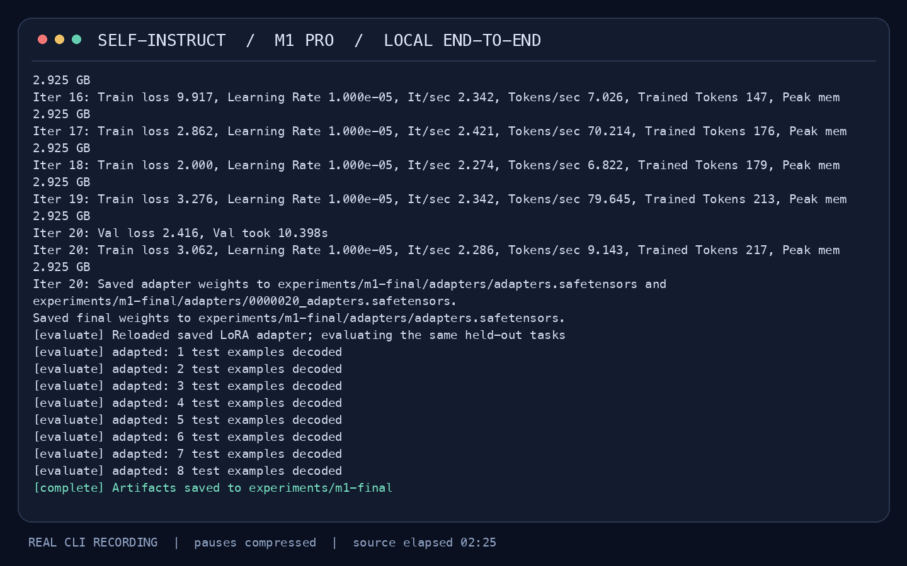
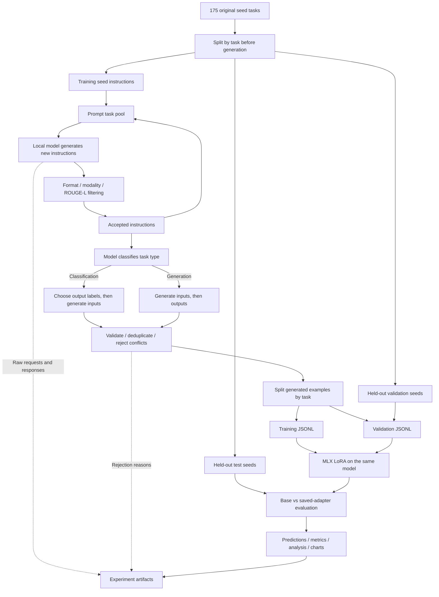
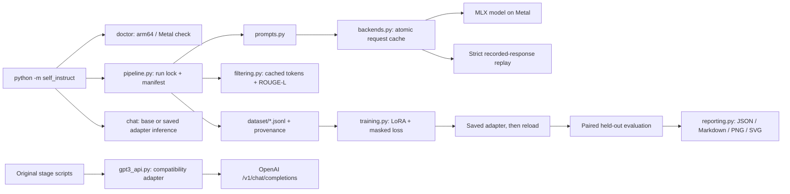
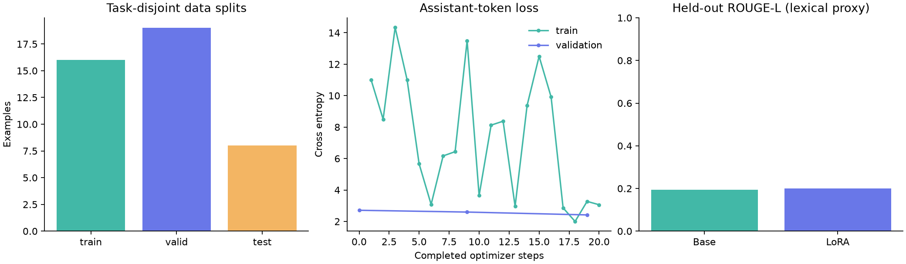

# Self-Instruct MLX

**English** | [简体中文](README.zh-CN.md)

A fully local Self-Instruct pipeline for Apple Silicon, powered by MLX. Generate instruction datasets, fine-tune language models with LoRA, and evaluate results with reproducible experiments, visual reports, and bilingual documentation.

Generate instruction data from a language model, filter it, fine-tune the same model, and evaluate the saved adapter — entirely on an M1 Mac. This is an adaptation of [Self-Instruct: Aligning Language Models with Self-Generated Instructions](https://arxiv.org/abs/2212.10560), preserving the original seed-driven bootstrapping algorithm and released datasets.

The default path uses **MLX + a pinned 4-bit Qwen3-4B-Instruct-2507 model**. Generation, LoRA training and inference run locally on Metal; no API key, CUDA, PyTorch or model server is needed. The original API workflow now uses **OpenAI Chat Completions** through the current Python SDK.

## Demo

[](docs/assets/demo.mp4)

**[Watch / download the MP4](docs/assets/demo.mp4)** · [Animated preview](docs/assets/demo.gif) · [Original timestamped terminal recording](docs/assets/demo.cast)

<video src="docs/assets/demo.mp4" controls preload="metadata" poster="docs/assets/demo-poster.png" width="960"></video>

The video records real subprocess output on an **M1 Pro / 16 GB**: environment check → new instruction generation → classification → examples → LoRA → held-out evaluation → saved-adapter inference. Pauses are compressed; the on-screen clock shows original elapsed time. The final review-classification prompt returns `Mixed`. Renderers that do not support inline video can use the MP4 link.

## Quick start on an M1 Mac

Use native **arm64 Python 3.11**, macOS 14 or later, and preferably **16 GB unified memory**. Validation used macOS 26.6.1; an 8 GB base M1 has not been hardware-tested. The first run downloads approximately 2.3 GB of public model weights into the Hugging Face cache. Keep roughly 6 GB free for the environment, model and results.

```bash
# From this repository's root. Install Python first if necessary:
brew install python@3.11
bash scripts/setup_m1.sh

# Complete real local experiment:
bash scripts/run_m1_demo.sh
```

Results appear in `runs/m1-demo/`. Run the same command again to resume interrupted generation, or verify the hashes of an already completed run. Changing configuration or seed data requires a new output directory.

Manual installation and execution:

```bash
python3.11 -m venv .venv
source .venv/bin/activate
python -m pip install -e '.[mlx,viz,dev]'
python -m self_instruct doctor
python -m self_instruct run --config configs/m1_demo.json --output runs/my-experiment
```

For the pinned, clean-install-tested dependency set, use `python -m pip install -r requirements-macos.lock.txt` with arm64 Python 3.11. The lock also includes the optional API and developer tools. `requirements.txt` installs the portable local runtime and visualization extras.

Use the model after training:

```bash
python -m self_instruct chat --run runs/my-experiment \
  --prompt 'Classify this review as positive, negative, or mixed. Return only the label. Review: Great food, slow service.'
# Add --base to compare with the model before adaptation.
```

## What remains Self-Instruct

1. Start with the original **175 human-written seed tasks**.
2. Sample seed instructions and previously accepted machine instructions to bootstrap new tasks.
3. Reject unsuitable instructions and those with **ROUGE-L > 0.7** against the task pool.
4. Ask the model whether each task is a classification task.
5. Generate classification instances **output first**; generate other instances **input first**.
6. Reject malformed, empty, duplicated or conflicting examples; retain at most five per task.
7. Fine-tune on the resulting instruction data.

The local implementation adapts the few-shot prompts to chat and uses structured JSON with explicit normalization for unambiguous array/object variants. It retains the original text parsers and prompt templates for the API workflow. Case is preserved, so identifiers such as NASA and Python are not lowercased accidentally.

The demo holds out seed tasks *before* prompting, uses only generated examples for training, and uses 20 LoRA steps. The paper used GPT-3 and a much larger dataset. This is a runnable implementation and small engineering experiment, **not a reproduction of the paper's quality gains**.

## Data flow



Held-out instructions are excluded from generation prompts and participate in novelty filtering. Sibling examples never cross splits. This prevents identical-task leakage; semantic overlap and pretraining contamination remain possible.

## Architecture and execution flow



The cache key includes the model, revision, full messages, generation limits, temperature and random seed. Responses and derived datasets use atomic replacement. Runs have an exclusive process lock, bounded generation/retry budgets, recorded provenance and output hashes. Interrupted **generation** resumes from completed requests; interrupted **training** restarts from the base model, because weights alone do not contain optimizer state.

## Saved experiment and measured results

The curated run is in **[experiments/m1-final](experiments/m1-final/)**. See [analysis](experiments/m1-final/analysis.md), [machine-readable metrics](experiments/m1-final/analysis.json), [experiment notes](experiments/README.md), and the [data quality review](experiments/quality_review.md).

| Measure | Recorded result |
|---|---:|
| New tasks / valid generated examples | 12 / 19 |
| Classification / generation tasks | 7 / 5 |
| Train / validation / test examples | 16 / 19 / 8 |
| LoRA steps / trainable parameters | 20 / 327,680 |
| Generation + classification inference | 43.33 s |
| Training including validation | 37.75 s |
| Peak MLX allocation: generation / training | 3.002 / 2.925 GB |
| Test loss: base → adapted | 3.0049 → 2.5868 |
| Test ROUGE-L: base → adapted | 0.1937 → 0.2003 |
| Exact match: base / adapted | 0 / 0 |
| Truncated answers: base / adapted | 6/8 / 6/8 |



Metrics use eight held-out seed tasks and greedy decoding with a fixed 128-token output cap. Exact match and ROUGE-L are lexical proxies; they are not human preference scores. Synthetic labels may be incorrect even when structural filters pass. The reports include truncation counts and predictions for inspection. Memory values are **MLX allocator peaks**, not whole-system RAM or process RSS.

A separate [filtering benchmark](experiments/filtering_benchmark.json) compared the original four-process pool created for every candidate with the cached-token implementation: **85.2× and 96.5× faster** across two repetitions, with maximum score difference `5.6e-17`. This covers 12 candidates against 175 seeds and includes macOS process startup; it is not a 52K-task scalability claim. ROUGE-L still performs exact pairwise comparisons.

## Reproduce and inspect

```bash
# Rebuild data without a model, downloads or network calls:
python -m self_instruct run --config configs/m1_demo.json \
  --output runs/replay --no-train \
  --replay-from experiments/m1-final/requests.jsonl

# Rebuild analysis from the saved evidence:
python -m self_instruct analyze experiments/m1-final

# Tests: no live API requests and no model downloads:
python -m pip install -e '.[dev,api]'
python -m pytest -q

# Re-measure the macOS filtering optimization:
python scripts/benchmark_filtering.py --instructions experiments/m1-final/instructions.jsonl
```

Replay runs parsing, filtering, splitting and export using the exact recorded responses; it does **not** generate new data or train a model. It preserves the original inference timings. On Linux, install `.[dev]` for core tests/replay; Metal inference and training require Apple Silicon. One real MLX loss-mask test is skipped when MLX is unavailable.

To make a new recording, install `ffmpeg` and use a **new** run directory:

```bash
brew install ffmpeg
python scripts/record_demo.py --run runs/video-demo --cast /tmp/self-instruct-demo.cast
# Re-render the checked-in recording without inference:
python scripts/record_demo.py --render-only
```

Configuration is explicit in [configs/m1_demo.json](configs/m1_demo.json): model revision, task count, random seed, generation budget, ROUGE threshold, held-out sizes, LoRA rank/layers and context limit. Copy it before changing settings. For larger datasets, increase `num_instructions`, `max_rounds` and `train_iters`; consider enabling `include_seed_tasks`. Results are stochastic across runtime/hardware versions, even with a fixed seed; replay gives exact data-processing reproducibility.

## OpenAI Chat Completions workflow

The historical filename `gpt3_api.py` and `make_requests()` positional arguments remain compatible. Calls now use `OpenAI().chat.completions.create()` at **`/v1/chat/completions`**, not `openai.Completion.create()` or `/v1/completions`.

- `engine` maps to `model`; each prompt becomes a separate chat request.
- `max_tokens` maps to `max_completion_tokens`; integer `logprobs` maps to `logprobs=True` and `top_logprobs`.
- Each prompt keeps its own `n` candidates; text, finish reason, refusal and usage metadata are preserved.
- `best_of` must be `1` or `None`. Unsupported model-specific controls are not silently discarded; callers can pass `None` for optional sampling controls.
- SDK retries and timeouts are bounded. Exhausted failures raise rather than silently adding empty training data.

Install `.[api]`, supply `OPENAI_API_KEY` through your environment, and set `OPENAI_MODEL` to a supported chat model available to your account. Optional `OPENAI_BASE_URL` configures a compatible endpoint. Then run the original four stages:

```bash
python -m pip install -e '.[api]'
# OPENAI_API_KEY and OPENAI_MODEL must already be set.
bash scripts/generate_instructions.sh
bash scripts/is_clf_or_not.sh
bash scripts/generate_instances.sh
bash scripts/prepare_for_finetuning.sh
```

These scripts default to the original **50,000-instruction** target; for a bounded API experiment, invoke `python -m self_instruct.bootstrap_instructions --help` and set a small target and `--max_requests`. Local quick start does not execute these API scripts. Model support for sampling, stop sequences and log probabilities varies. API transport/compatibility is tested with the real SDK and a mocked HTTP transport; no paid OpenAI experiment was run.

Optional cloud fine-tuning is available through `bash scripts/finetune_gpt3.sh TRAIN_FILE EXPERIMENT_NAME --model YOUR_FINE_TUNABLE_MODEL`. This converts prompt/completion data to chat messages, uploads it, and creates a job through `client.fine_tuning.jobs.create()`; running it incurs provider charges. The local LoRA path needs no cloud service. See the official [Chat Completions reference](https://developers.openai.com/api/reference/resources/chat/subresources/completions/methods/create) and [fine-tuning reference](https://developers.openai.com/api/reference/resources/fine_tuning/subresources/jobs/methods/create).

## Repository and original data

```text
self_instruct/        Local pipeline, model backend, training, reports and original API stages
configs/              Pinned, bounded demo configuration
scripts/              Setup, runnable demos, recording and filtering benchmark
experiments/m1-final/  Raw responses, task labels, datasets, adapter, predictions and analysis
docs/assets/          Real terminal recording, MP4, GIF and poster
tests/                Pipeline, filtering, loss-mask and Chat Completions regression tests
data/                 Original seeds and released training data (unchanged)
human_eval/           Original expert-written evaluation tasks (unchanged)
```

The released **52K instructions / 82K instances** remain at [data/gpt3_generations/batch_221203/all_instances_82K.jsonl](data/gpt3_generations/batch_221203/all_instances_82K.jsonl). The original prompt/completion training data remain under [data/finetuning/self_instruct_221203](data/finetuning/self_instruct_221203/). The [252 human evaluation tasks](human_eval/README.md), original [pipeline illustration](docs/pipeline.JPG), and [original README](docs/README.original.md) are retained. Optional exploratory notebook dependencies install with `.[notebook]`.

Within a run, `requests.jsonl` contains full prompts/responses; `instructions.jsonl`, `classifications.jsonl`, `instances.jsonl` and `rejected_*.jsonl` expose the data stages. `dataset/*_provenance.jsonl` maps every example to its source task. `training_metrics.jsonl`, `tokenization.json`, `evaluation/`, `analysis.*` and `manifest.json` record training, exclusions, evaluation, analysis and integrity evidence. The small final adapter is included; base model weights stay in your Hugging Face cache.

## Troubleshooting

| Symptom | Action |
|---|---|
| Metal unavailable / x86_64 Python | Use an arm64 terminal and Homebrew Python, then recreate the virtual environment. |
| Model download fails | Check Hugging Face connectivity and free disk space; rerun to resume the cache download. |
| Offline use | Download the pinned model once, then set `HF_HUB_OFFLINE=1`; replay requires no model at all. |
| Out of memory | Close other memory-heavy apps; lower LoRA layers/context or select a smaller MLX model in a copied config and new run directory. |
| Budget exhausted | Inspect raw responses/rejections, improve the model/prompt or increase `max_rounds` in a new config. |
| Empty tokenized split | Increase `max_seq_length`; exclusions are explicit in `tokenization.json`, never silently clipped. |
| Configuration or artifact mismatch | Choose a fresh output directory; do not mix results from different configurations. |
| API 400 / model unavailable | Select an account-accessible chat model and supported parameters; retired `davinci` models are no longer defaults. |

## Citation and license

```bibtex
@misc{selfinstruct,
  title={Self-Instruct: Aligning Language Model with Self Generated Instructions},
  author={Wang, Yizhong and Kordi, Yeganeh and Mishra, Swaroop and Liu, Alisa and Smith, Noah A. and Khashabi, Daniel and Hajishirzi, Hannaneh},
  journal={arXiv preprint arXiv:2212.10560},
  year={2022}
}
```

Repository code retains the [Apache 2.0 license](LICENSE). Consult the [pinned model repository](https://huggingface.co/mlx-community/Qwen3-4B-Instruct-2507-4bit/tree/50d427756c6b1b2fe0c0a10f67fbda1fc8e82c1b) for model artifacts and licensing, and the [MLX-LM project](https://github.com/ml-explore/mlx-lm) for the local runtime.
