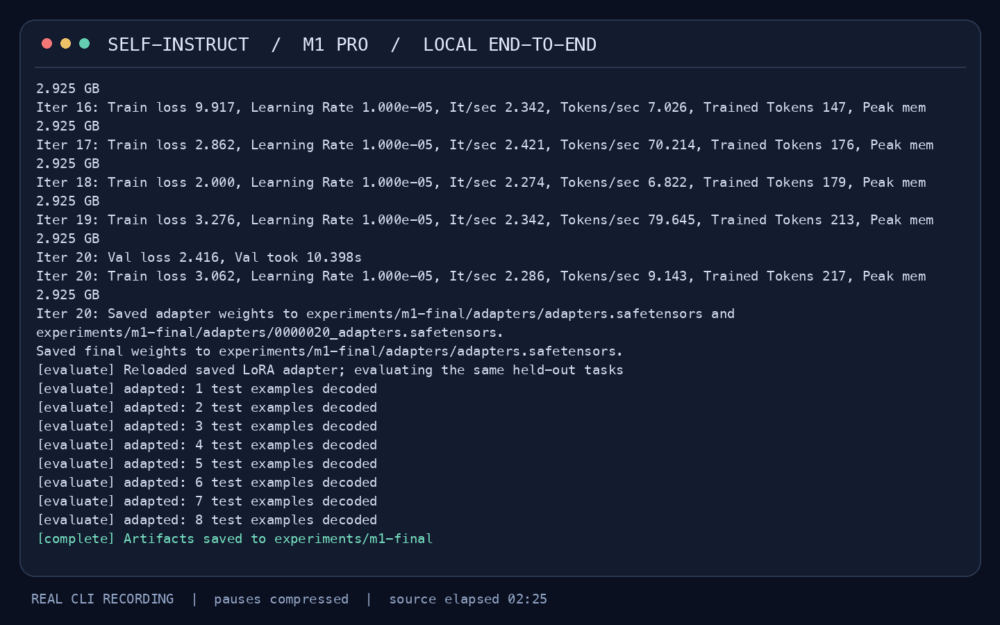
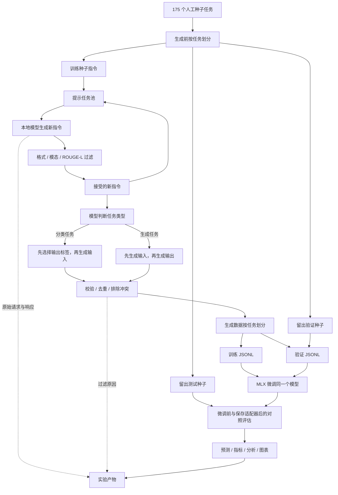
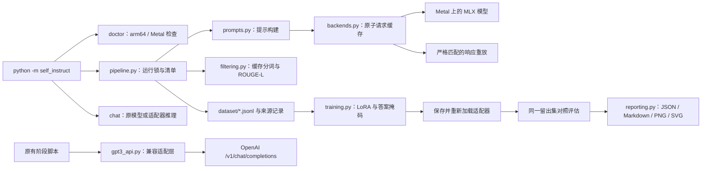
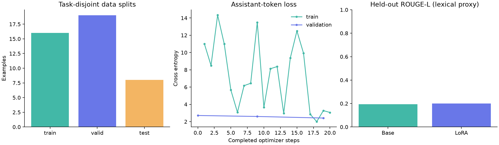

# Self-Instruct MLX

[English](README.md) | **简体中文**

基于 MLX、面向 Apple Silicon 的全本地 Self-Instruct 流水线：生成指令数据集、使用 LoRA 微调语言模型，并通过可复现实验、可视化报告和双语文档评估与展示结果。

在 M1 Mac 上完成**模型自生成指令 → 数据筛选 → 微调同一个模型 → 评估保存的适配器**。本项目改造自 [Self-Instruct: Aligning Language Models with Self-Generated Instructions](https://arxiv.org/abs/2212.10560)，保留原始种子驱动的自举算法及公开数据集。

默认使用 **MLX + 固定版本的 4-bit Qwen3-4B-Instruct-2507**，生成、LoRA 训练和推理均通过 Metal 在本机运行，不需要 API Key、CUDA、PyTorch 或模型服务。原有 API 流程也已升级为现代 Python SDK 的 **OpenAI Chat Completions**。

## 演示视频

[](docs/assets/demo.mp4)

**[观看或下载 MP4](docs/assets/demo.mp4)** · [GIF 预览](docs/assets/demo.gif) · [保留原始时间戳的终端记录](docs/assets/demo.cast)

<video src="docs/assets/demo.mp4" controls preload="metadata" poster="docs/assets/demo-poster.png" width="960"></video>

视频记录 **M1 Pro / 16 GB** 上实际执行的命令：环境检查 → 新指令生成 → 任务分类 → 实例生成 → LoRA → 留出集评估 → 加载适配器推理。等待时间经过压缩，画面底部显示原始运行时间。最后的评论分类示例返回 `Mixed`。如果 Markdown 阅读器不支持内嵌视频，请点击 MP4 链接。

## M1 Mac 快速开始

使用原生 **arm64 Python 3.11**、macOS 14 或更新版本，建议 **16 GB 统一内存**。实测系统为 macOS 26.6.1；尚未在 8 GB 基础款 M1 上做硬件验证。首次运行会向 Hugging Face 缓存下载约 2.3 GB 的公开模型权重。建议为环境、模型和结果保留约 6 GB 磁盘空间。

```bash
# 在仓库根目录执行；如果还没有 Python 3.11：
brew install python@3.11
bash scripts/setup_m1.sh

# 运行真实的完整本地实验：
bash scripts/run_m1_demo.sh
```

结果保存在 `runs/m1-demo/`。再次执行相同命令会复用已完成的生成请求，或者校验已完成实验的文件哈希。修改配置或种子数据时，请使用新的输出目录。

也可以手动安装和执行：

```bash
python3.11 -m venv .venv
source .venv/bin/activate
python -m pip install -e '.[mlx,viz,dev]'
python -m self_instruct doctor
python -m self_instruct run --config configs/m1_demo.json --output runs/my-experiment
```

使用已通过干净环境安装验证的锁定依赖：在 arm64 Python 3.11 下执行 `python -m pip install -r requirements-macos.lock.txt`。该锁文件还包含可选 API 和开发工具。`requirements.txt` 则安装本地运行与可视化依赖，允许安装器按平台选择兼容的间接依赖。

训练完成后使用保存的模型适配器：

```bash
python -m self_instruct chat --run runs/my-experiment \
  --prompt 'Classify this review as positive, negative, or mixed. Return only the label. Review: Great food, slow service.'
# 添加 --base 可以查看微调前模型的回答。
```

## 保留的核心思想与功能

1. 从原始 **175 个人工种子任务**开始。
2. 混合抽取种子指令和已接受的机器指令，继续自举扩展任务池。
3. 筛除不适合纯文本模型的任务，以及与任务池 **ROUGE-L > 0.7** 的指令。
4. 由模型判断任务是否属于分类任务。
5. 分类任务采用**先输出标签、后生成输入**；其他任务采用**先输入、后输出**。
6. 筛除格式错误、空输出、重复或冲突的实例，每个任务最多保留五个。
7. 使用生成的指令数据微调模型。

本地实现将少样本提示适配到聊天模型，并采用 JSON 格式；仅对字段含义明确的数组、对象形式做规范化。原始文本解析器和提示模板继续用于 API 流程。指令保留原始大小写，不会把 NASA、Python 等标识符意外转成小写。

演示配置在生成之前划分留出任务，训练仅使用机器生成的例子，执行 20 个 LoRA 步骤。原论文使用 GPT-3 和大规模数据。本实验用于证明流程能够完整运行，**不等同于复现论文中的质量提升**。

## 数据流图



留出任务不进入生成提示词，并参与新指令的相似度过滤。同一任务的多个实例不会跨集合。这样可以排除完全相同任务的泄漏，但不能证明不存在语义重叠或预训练数据污染。

## 结构与执行流程图



缓存键包含模型、版本、完整消息、生成上限、温度和随机种子。响应和数据集使用原子文件替换；实验具有进程锁、有限的生成及重试预算、数据来源记录和产物哈希。中断的**生成阶段**复用已完成请求；中断的**训练阶段**从原模型重新训练，不把仅包含权重的文件误当成保存了优化器状态的完整检查点。

## 实验数据与实测结果

最终实验保存在 **[experiments/m1-final](experiments/m1-final/)**。可查看[分析报告](experiments/m1-final/analysis.md)、[机器可读指标](experiments/m1-final/analysis.json)、[实验说明](experiments/README.md)和[数据质量复核](experiments/quality_review.md)。

| 指标 | 实测结果 |
|---|---:|
| 新任务 / 通过结构过滤的生成实例 | 12 / 19 |
| 分类任务 / 生成任务 | 7 / 5 |
| 训练 / 验证 / 测试实例 | 16 / 19 / 8 |
| LoRA 步数 / 可训练参数 | 20 / 327,680 |
| 生成与任务分类推理耗时 | 43.33 s |
| 含验证的训练耗时 | 37.75 s |
| MLX 分配峰值：生成 / 训练 | 3.002 / 2.925 GB |
| 测试损失：微调前 → 后 | 3.0049 → 2.5868 |
| 测试 ROUGE-L：微调前 → 后 | 0.1937 → 0.2003 |
| 完全匹配率：微调前 / 后 | 0 / 0 |
| 截断答案：微调前 / 后 | 6/8 / 6/8 |



评估使用八个留出种子任务、贪心解码和固定的 128-token 输出上限。Exact Match 和 ROUGE-L 是词面指标，不代表人工偏好。通过结构过滤的合成标签仍可能不正确；报告保留了截断数量和逐条预测，方便检查。内存指标是 **MLX 分配器峰值**，不是全系统内存或进程 RSS。

另有独立的[过滤性能实验](experiments/filtering_benchmark.json)：比较原始“每个候选启动四进程池”和缓存分词实现，两次重复分别加速 **85.2 倍、96.5 倍**，最大得分差异为 `5.6e-17`。范围是 12 个候选与 175 个种子的比较，包含 macOS 启动进程的耗时，不能外推为 52K 任务规模下的加速比。算法仍执行精确的逐对 ROUGE-L 比较。

## 复现与检查

```bash
# 无需模型、下载或网络，重放已保存响应，重建数据处理结果：
python -m self_instruct run --config configs/m1_demo.json \
  --output runs/replay --no-train \
  --replay-from experiments/m1-final/requests.jsonl

# 从已保存证据重新生成分析：
python -m self_instruct analyze experiments/m1-final

# 不调用真实 API，也不下载模型的测试：
python -m pip install -e '.[dev,api]'
python -m pytest -q

# 重测 macOS 过滤性能：
python scripts/benchmark_filtering.py --instructions experiments/m1-final/instructions.jsonl
```

重放会实际执行解析、过滤、数据划分和导出，但**不会生成新数据或训练模型**。报告中的推理耗时仍是原始录制值。Linux 上可安装 `.[dev]` 执行核心测试和重放；Metal 推理和训练需要 Apple Silicon。没有 MLX 时会跳过一个实际 MLX 损失掩码测试。

录制新视频时先安装 `ffmpeg`，并使用**新的实验目录**：

```bash
brew install ffmpeg
python scripts/record_demo.py --run runs/video-demo --cast /tmp/self-instruct-demo.cast
# 只重新渲染仓库中的录像，不执行推理：
python scripts/record_demo.py --render-only
```

[configs/m1_demo.json](configs/m1_demo.json) 显式定义模型版本、任务数量、随机种子、生成预算、ROUGE 阈值、留出集规模、LoRA 层数及秩、上下文长度。调整时复制一份配置；规模化运行可增加 `num_instructions`、`max_rounds` 和 `train_iters`，并考虑启用 `include_seed_tasks`。固定随机种子仍不能保证跨硬件、跨运行时版本逐 token 相同；响应重放提供精确的数据处理复现。

## OpenAI Chat Completions 流程

为兼容原项目，保留 `gpt3_api.py` 文件名和 `make_requests()` 的位置参数。底层已改为 `OpenAI().chat.completions.create()`，调用 **`/v1/chat/completions`**，不再使用 `openai.Completion.create()` 或 `/v1/completions`。

- `engine` 映射为 `model`，每个提示词转换为一条独立聊天请求。
- `max_tokens` 映射为 `max_completion_tokens`；整数 `logprobs` 转为 `logprobs=True` 和 `top_logprobs`。
- 每个提示词保留自身的 `n` 个候选，保存文本、结束原因、拒绝信息及 usage。
- `best_of` 只能是 `1` 或 `None`。不会静默丢弃模型不支持的参数；函数调用者可以为可选采样参数传入 `None`。
- SDK 的重试次数和超时有明确上限；请求最终失败会报错，不会悄悄生成空训练数据。

安装 `.[api]`，通过环境提供 `OPENAI_API_KEY`，并把 `OPENAI_MODEL` 设为账号有权限使用的聊天模型。可选的 `OPENAI_BASE_URL` 用于兼容接口地址。随后可运行原有四个阶段：

```bash
python -m pip install -e '.[api]'
# 执行前确保 OPENAI_API_KEY 和 OPENAI_MODEL 已设置。
bash scripts/generate_instructions.sh
bash scripts/is_clf_or_not.sh
bash scripts/generate_instances.sh
bash scripts/prepare_for_finetuning.sh
```

这些脚本仍保留原来的 **50,000 条指令**目标。小规模 API 实验请使用 `python -m self_instruct.bootstrap_instructions --help`，显式设置较小任务数和 `--max_requests`。本地快速开始不会调用这些 API 脚本。不同模型对采样参数、stop 和 logprobs 的支持不同。API 路径已通过真实 SDK 加模拟 HTTP 传输测试；本次没有执行付费 OpenAI 实验。

可选的云端微调入口：`bash scripts/finetune_gpt3.sh TRAIN_FILE EXPERIMENT_NAME --model YOUR_FINE_TUNABLE_MODEL`。它将 prompt/completion 转换为聊天数据，上传文件并通过 `client.fine_tuning.jobs.create()` 创建任务；执行该命令会产生供应商费用。本地 LoRA 不需要云服务。接口依据：[官方 Chat Completions 文档](https://developers.openai.com/api/reference/resources/chat/subresources/completions/methods/create)、[官方微调任务文档](https://developers.openai.com/api/reference/resources/fine_tuning/subresources/jobs/methods/create)。

## 目录与原始数据

```text
self_instruct/        本地流水线、模型后端、训练、报告及原始 API 阶段
configs/              固定模型版本、限制实验规模的配置
scripts/              安装、演示、录像与过滤性能测试
experiments/m1-final/  原始响应、分类、数据集、适配器、预测及分析
docs/assets/          真实终端记录、MP4、GIF 和封面
tests/                流水线、过滤、掩码和 Chat Completions 回归测试
data/                 原始种子和公开训练数据，保持不变
human_eval/           原始专家编写的评估任务，保持不变
```

公开的 **52K 指令 / 82K 实例**仍位于 [data/gpt3_generations/batch_221203/all_instances_82K.jsonl](data/gpt3_generations/batch_221203/all_instances_82K.jsonl)，原始 prompt/completion 训练数据位于 [data/finetuning/self_instruct_221203](data/finetuning/self_instruct_221203/)。保留了 [252 个人工评估任务](human_eval/README.md)、[原始流程图](docs/pipeline.JPG)和[原始 README](docs/README.original.md)。探索性 notebook 的依赖可通过 `.[notebook]` 单独安装。

实验中的 `requests.jsonl` 保存完整提示词和响应；`instructions.jsonl`、`classifications.jsonl`、`instances.jsonl`、`rejected_*.jsonl` 展示各个数据处理阶段。`dataset/*_provenance.jsonl` 记录样本来源。`training_metrics.jsonl`、`tokenization.json`、`evaluation/`、`analysis.*` 和 `manifest.json` 保存训练、排除记录、评估、分析及完整性证据。最终的小型适配器已包含在仓库中；基础模型权重保存在 Hugging Face 缓存。

## 常见问题

| 问题 | 处理方法 |
|---|---|
| Metal 不可用 / Python 为 x86_64 | 使用 arm64 终端和 Homebrew Python，重新建立虚拟环境。 |
| 模型下载失败 | 检查 Hugging Face 连通性和磁盘空间，再运行以继续缓存下载。 |
| 离线运行 | 首次下载固定版本模型后设置 `HF_HUB_OFFLINE=1`；响应重放完全不需要模型。 |
| 内存不足 | 关闭其他占内存应用，减少 LoRA 层数或上下文，或在新配置中选择更小的 MLX 模型。 |
| 生成预算耗尽 | 查看原始响应和拒绝原因，改进模型或提示词，或在新配置中增加 `max_rounds`。 |
| 分词后集合为空 | 增大 `max_seq_length`；超长记录在 `tokenization.json` 中列明，不会静默截掉答案。 |
| 配置或产物哈希不匹配 | 使用新的输出目录，不混合不同配置的结果。 |
| API 400 / 模型不可用 | 选择账号可用的聊天模型及其支持的参数；默认值中已去除过时的 `davinci`。 |

## 引用与许可

```bibtex
@misc{selfinstruct,
  title={Self-Instruct: Aligning Language Model with Self Generated Instructions},
  author={Wang, Yizhong and Kordi, Yeganeh and Mishra, Swaroop and Liu, Alisa and Smith, Noah A. and Khashabi, Daniel and Hajishirzi, Hannaneh},
  journal={arXiv preprint arXiv:2212.10560},
  year={2022}
}
```

仓库代码保留 [Apache 2.0 许可](LICENSE)。模型文件及其许可见[固定版本模型仓库](https://huggingface.co/mlx-community/Qwen3-4B-Instruct-2507-4bit/tree/50d427756c6b1b2fe0c0a10f67fbda1fc8e82c1b)，本地运行时见 [MLX-LM](https://github.com/ml-explore/mlx-lm)。
