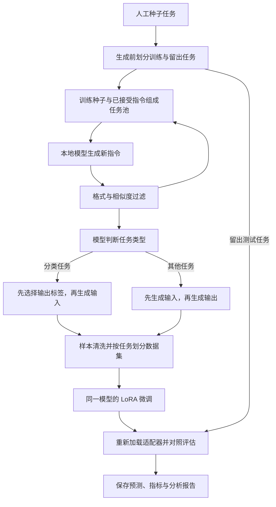

## Self-Instruct MLX：在 M1 Mac 上完成指令生成与模型微调

[Self-Instruct MLX](https://github.com/InfronAI/Self-Instruct-MLX) 将 Self-Instruct 的“模型生成训练数据，再用这些数据微调自身”流程迁移到 Apple Silicon。默认使用 4-bit Qwen3-4B-Instruct-2507，通过 MLX 和 Metal 在本地完成生成、LoRA 微调及评估；首次下载模型后，无需云端推理服务或 API Key。

### 架构与组件

项目以 Python 命令行工具组织各处理阶段，通过 JSON/JSONL 文件传递配置和数据。

| 组件 | 主要职责 |
|---|---|
| `cli.py`、`pipeline.py` | 提供命令入口，编排实验，检查配置，管理运行状态与生成请求恢复。 |
| `backends.py` | 加载本地模型、执行推理，缓存请求与响应，支持严格匹配的历史响应重放。 |
| `prompts.py`、`filtering.py` | 构造提示词，校验生成格式，使用 ROUGE-L 筛除相似指令，过滤重复和冲突样本。 |
| `training.py` | 执行 LoRA 微调，保存并重新加载适配器，对比微调前后的模型表现。 |
| `artifacts.py`、`reporting.py` | 保存实验产物和文件哈希，汇总指标，生成 Markdown 报告及图表。 |

### 数据处理流程



流程从原始的 175 个人工种子任务开始。系统先划分训练、验证和测试任务，再抽取训练种子与已接受的新指令组成少样本提示，逐步扩展任务池。默认筛除 ROUGE-L 相似度高于 0.7 的候选指令，并限制生成轮数和重试次数。

实例生成保留原方法的两种策略：分类任务先确定标签，再生成对应输入；其他任务先生成输入，再给出输出。清洗后的样本转为 `messages` 格式，并按任务划分数据集，避免同一任务的不同样本跨集合。默认演示仅使用机器生成的样本进行训练。

微调时冻结基础模型权重，只训练 LoRA 参数，损失仅计算有效回答 token，排除提示词和填充部分。训练结束后从磁盘重新加载适配器，在相同留出任务上比较 loss、困惑度、ROUGE-L 和完全匹配率，同时保存逐条预测结果。

### 接口与实验产物

主要使用接口是命令行，实验规模、模型版本和训练参数集中在 `configs/m1_demo.json`：

```bash
# 检查环境并运行完整实验
python -m self_instruct doctor
python -m self_instruct run --config configs/m1_demo.json --output runs/blog-demo

# 使用保存的适配器推理，并重新生成分析报告
python -m self_instruct chat --run runs/blog-demo --prompt 'Write a short greeting.'
python -m self_instruct analyze runs/blog-demo
```

内部推理接口为 `MLXBackend.complete(messages, ...)`，返回生成文本、token 数、耗时和内存等信息。项目另外保留可选的 OpenAI Chat Completions 路径，由 `gpt3_api.py` 适配原始分阶段脚本；默认本地流程直接调用 MLX。

每次实验保存原始请求与响应、筛选记录、训练数据、LoRA 适配器、评估预测和分析图表。`manifest.json` 记录配置、环境及产物哈希；历史响应可通过 `--no-train --replay-from` 重放数据处理阶段，便于核查结果和定位问题。

默认演示生成 12 条新指令并执行 20 步 LoRA 训练，用于验证完整流程。由于采用已完成指令微调的本地模型和小规模数据，其结果不等同于原论文的 GPT-3 实验，也不能据此推断普遍的模型能力提升。
